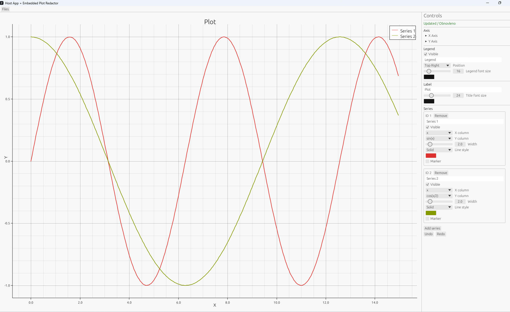

# KiThePlot

Tiny but functional plot redactor built with `egui` + `plotters`.

It can run as a standalone desktop app, and it can also be embedded into another Rust crate as a library component.

## Project news
moved to egui 0.35
## What it does

- Imports numeric tabular data from:
  - CSV
  - TXT (whitespace separated)
- Displays interactive chart preview.
- Lets users fine tune plot configuration:
  - Axis labels, scale, min/max range
  - Major/minor ticks
  - Legend visibility, position, font size/color
  - Chart title + title font size/color
  - Symmetric or asymmetric X/Y uncertainty columns
  - Series list with per-series controls:
    - visibility
    - x/y column mapping
    - line width/style/color
    - marker toggle
- Supports undo/redo for editing actions.
- Exports chart image with current design:
  - PNG
  - SVG
- Embeds Noto Sans, Noto Serif, and Noto Sans Mono for portable chart typography and Cyrillic labels.
- Allows host applications to register additional TrueType/OpenType chart fonts for preview and export.

## Architecture (MVC)

- `model`: pure data structures and input parsing.
  - `DataSource` trait for host-provided data.
  - `DataTable` normalized internal table.
  - plot configuration types (`PlotModel`, axes, legend, series, styles).
- `view`: egui UI widgets. Emits typed actions.
- `controller`: validates actions, applies commands, manages undo/redo, import/export.

Dataflow:

`View -> Action -> Controller -> Model -> View`

## Standalone usage

```bash
cargo run
```

In the app:
- use `Files -> From CSV` or `Files -> From TXT`
- adjust chart settings from right panel
- use `Files -> Save as...` to export PNG/SVG

The publication export controls set the figure's physical width and height in millimeters or inches. Presets cover single-column, double-column, square, and 16:9 slide figures. The plot preview matches the selected export aspect ratio by default; turn off **Preview at export aspect ratio** to fill the available editor area instead. PNG embeds the chosen DPI as physical-resolution metadata; SVG stores physical dimensions while retaining its pixel viewBox. The controls show the resulting pixel dimensions before export. Chart font sizes remain fixed in output pixels, so their printed size in points is `pixels × 72 / DPI`.

## Embedding as library

The crate exposes:

- `kithe_plot::PlotEditorApp`
- `kithe_plot::model::DataSource`
- `PlotController::load_from_data_source(&dyn DataSource)`

See full working example:

```bash
cargo run --example host_app
```

File: [examples/host_app.rs](examples/host_app.rs)

The example creates a custom host-side data source and injects it into the embedded editor.

Host applications can register a chart font once an egui context is available, then select the registered family in `PlotModel`:

```rust
let asset_id = kithe_plot::register_chart_font(ui.ctx(), "Lab Sans", font_bytes)?;
app.controller_mut().model.layout.font_family =
    kithe_plot::model::PlotFontFamily::CustomAsset {
        family: "Lab Sans".to_owned(),
        asset_id,
    };
```

The active custom font asset is embedded in `.kplot` projects. Embedding applications can register a font before selecting it, and projects opened with a custom font register the embedded asset automatically. SVG exports also embed the selected font so the chart keeps its typography when opened on another machine.

Font sizes are pixel sizes. Resizing the export canvas changes the available chart area while keeping the configured font sizes fixed, matching a preview rendered at the same pixel dimensions.

## Public API sketch

```rust
use kithe_plot::PlotEditorApp;
use kithe_plot::model::DataSource;
```

- create `PlotEditorApp`
- call `app.controller_mut().load_from_data_source(...)`
- run inside your `eframe` host window

## Status

This project intentionally stays small and pragmatic: enough features to edit real plots, export results, and integrate into larger Rust GUI applications.


## License

This project is licensed under the MIT License - see the [LICENSE](LICENSE) file for details.
